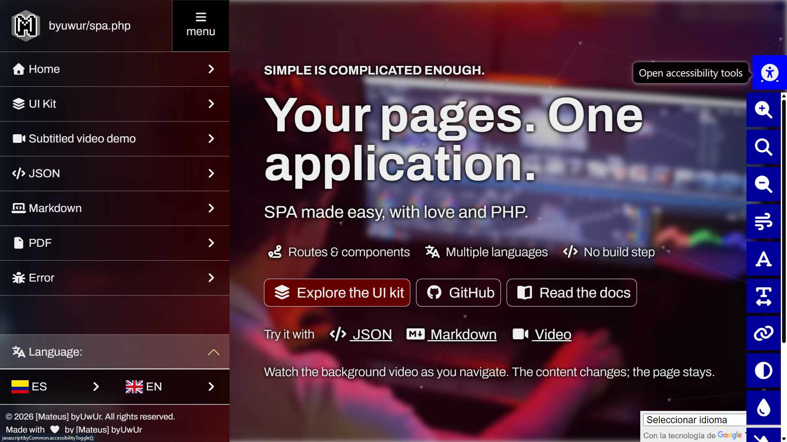

# byuwur/spa.php



A PHP single-page application framework with server-side routing, jQuery page/component loading, shared UI, and request/session helpers.

[Demo](https://byuwur.co/spa.php/) · [Static HTML version: SPA.js](https://github.com/byuwur/spa.js)

## Installation

Requires PHP 8.1+ and jQuery. Optional features need their bundled libraries.

```bash
git clone https://github.com/byuwur/spa.php.git
```

Serve the checkout with PHP and open `demo/`; the root entry points redirect there.

## How is it done?

The application owns its shell, configuration, pages, components, and dictionaries. The framework normally lives in a submodule:

```text
application-root/
|-- home.php        # Shell and route entry point
|-- _init.php       # Application initializer
|-- _routes.php     # Route table
|-- .htaccess       # Rewrite rules, or equivalent Nginx configuration
`-- spa.php/        # Framework
```

1. Copy the demo shell and framework `_init.php` into your application. Each SPA needs its own initializer and routes.
2. Load `_init.php` and `_routes.php` (which defines `$routes`) before `_router.php`; map routes/components to PHP pages.
3. Route non-file requests to `home.php?uri=...`. Update server rules if you rename the shell.

The framework's initializer is a template; loading it directly derives the wrong application paths. The demo uses its parent as the framework root. Keep application `.env`, Composer files, and configuration outside the framework; use `.env.example` when needed.

| Files                                      | Purpose                                              |
| ------------------------------------------ | ---------------------------------------------------- |
| `_init.php`, `_router.php`                 | Bootstrap, route resolution, and browser state.      |
| `_spa.js`                                  | AJAX navigation, history, components, and lifecycle. |
| `_functions.php`, `_functions.js`          | Server/browser utilities and request helpers.        |
| `_common.php`, `_common.js`, `_common.css` | Defaults, shared UI, and styles.                     |
| `_fonts.js`                                | Optional Google Fonts loading and pickers.           |
| `_auth.php`, `_config.php`, `_plugins.php` | Optional sessions/CSRF, MySQL, and Composer setup.   |
| `_error.php`                               | Standalone HTTP error page.                          |
| `css/`, `js/`, `img/`, `cacert.pem`        | Bundled libraries, assets, and cURL certificates.    |

Application `_common.php`, `_auth.php`, `_config.php`, and `_plugins.php` can extend framework setup. Load only the libraries you use; remote integrations still require their services. Shared CSS images stay in the framework's `img/` directory.

Since v14, `_var.php` is `_init.php`; update old includes. No compatibility alias exists.

## Runtime contracts

### Routes and navigation

- Fragments use POST and path history. Route GET/POST values override `/$/` parameters, which override queries. Component GET values override URI queries; `uri=false` remains authoritative.
- Only the first `?` separates path/query; later question marks remain in values. `get_url_param()` also reads hash queries.
- Navigation emits `bySPA:before-unload`, then one `bySPA:load` or `bySPA:error`. Error details are `{ navigationId, url, status, error }`; status `0` means no transport status. `bySPA.REQUEST_TIMEOUT` defaults to 30 seconds.
- Superseded work stops, including when lifecycle listeners start another navigation. Unknown routes report one error; failed error-page loading adds none. FILE routes leave without a load event; initial routes rejected by PHP never begin a browser lifecycle.
- `HOME_PATH` resolves requests/history. Ordinary same-origin clicks route, including root-relative virtual paths. Modified/middle clicks, targets, downloads, hashes, and `custom-folder="true"` stay native. Smooth scrolling requires an existing ID in the same document, origin, path, and query.
- `bySPA.VERSION` identifies the framework; `bySPA.APP_VERSION` identifies the application.

### Storage and shared UI

Each installed API owns one boolean `initialized` flag. Bootstrap scripts can populate the shared namespace before `_spa.js` sets `bySPA.initialized = true`. Repeated imports preserve storage fallback values and active navigation; ordinary `byCommon.init()` calls still initialize new page content.

`byStorage` namespaces keys by application root and removes legacy keys after migration. Failed writes/removals give only that key a local value/null marker until a successful explicit change; other keys keep reading persistent storage. Removal also clears legacy copies. Memory fallback lasts for this runtime, without automatic replay or cross-tab synchronization.

`byCommon.init()` initializes shared UI after navigation. Optional warnings are off; enable `byCommon.INIT_WARNINGS` or `{ showWarn: true }`. `byCommon.initBootstrap({ tooltipsOnly: true, root, refreshTooltips: true })` refreshes scoped tooltips without rerunning other components.

Modal cleanup destroys optional font controls and removes the captured element, preserving replacements with the same ID. `byCommon.accessibilityText(mode)` adjusts root size by `0.25rem` for `"plus"`/`"minus"`, within `0.5rem`–`3rem`; no argument resets `1rem`.

Data, HTML-text escaping, and CSRF utilities are native. UI and HTTP/form helpers use jQuery; modals also need Bootstrap. WebSocket transport is native, with jQuery DOM logging.

### Compressed URL data

`compress_url_data(text)` and `decompress_url_data(token, maxBytes = 1048576)` use native raw DEFLATE, unpadded Base64url, and Promises without jQuery or SPA initialization.

```js
const token = await compress_url_data(JSON.stringify(settings));
const restored = JSON.parse(await decompress_url_data(token));
```

Requires native `CompressionStream`/`DecompressionStream` support for `deflate-raw`. Decompression rejects malformed data/UTF-8 and output exceeding the positive safe-integer UTF-8 byte limit. Callers own JSON, validation, URL parameters, and format markers.

### Optional Google Fonts

`_fonts.js` loads fonts natively with caching and offline fallbacks. Optional pickers need jQuery, Select2, `_common.css`, and `data-font-picker` controls:

```html
<script src="./spa.php/_fonts.js" defer></script>
<input name="fontFamily" data-font-picker value="Inter" />
```

`byFont.family(value, fallback)` returns a CSS stack; `await byFont.ready(value, weight, text)` returns readiness before measurement. Use `byFont.init(container)` / `byFont.destroy(container)` for dynamic fields, or `byFont.picker(field, { weight, previewText, fallback })` for one control; `weight` can be a control.

`byCommon.init()` enhances marked fields; navigation/modal cleanup disposes them. Repeated initialization preserves widgets; absent optional libraries leave ordinary controls usable. Applications own font values and persistence.

### Fragment scripts and error pages

Fragments are trusted application HTML. Ordered external/inline scripts, `defer`, and modules preserve source order and attributes; explicit external `async` scripts run independently. Failures log and continue; stale fragments stop. `bySPA:load` waits for ordered page/component scripts. Sequencing uses `async`/`await`; public requests retain jQuery promises.

Error pages replace the full document. Back reloads a clean runtime, including while error-page scripts load.

## Security basics

Applications own authorization and must sanitize untrusted HTML. `_auth.php` uses strict sessions and regenerates login session IDs; require CSRF checks on state-changing endpoints. Browser request helpers prefer a meta token, then `sessionStorage.CSRF_TOKEN`:

```php
<meta name="csrf-token" content="<?= htmlspecialchars(csrf_token(), ENT_QUOTES, "UTF-8") ?>" />
```

- `session_check()` preserves GET/POST. Initial form POST data is forwarded once, never stored in history. PHP `make_http_request()` does not retry ambiguous POST failures.
- Session-ID forwarding requires `ALLOW_POST_SESSION_ID` and a URL matching `APP_URL`. Behind proxies, set `APP_URL` or configure exact `TRUSTED_PROXIES` with `TRUST_PROXY`; validate outbound URLs.
- SQL UPDATE/DELETE needs a restrictive condition or explicit `allow_full_table => true`. Empty `NOT IN []` is not restrictive and strict mode rejects it. Trusted SQL fragments are not checked for tautologies.
- Block every `tests` path segment, including submodules. Nginx denial must precede PHP handling and sit outside overriding `^~` locations. Test scripts are CLI-only.
- Track application `composer.lock` for reproducible installs.

## Maintaining a submodule integration

Keep `_fonts.js`, `_functions.js`, `_common.js`, and `_common.css` identical across both SPAs; SPA.php owns the shared source. `_spa.js`, routing, transport, history, and application bootstrap retain host-specific behavior.

For upgrades, review changes, reconcile application-owned `_init.php`/`_routes.php` without losing settings, run checks, and test the consumer. Submodule updates do not update copied initializers. Neither repository synchronizes the other automatically.

### Checks

```bash
node --test tests/common.test.js tests/fragment_scripts.test.js tests/routing.test.js tests/storage.test.js tests/parity.test.js tests/fonts.test.js
node --test tests/browser.test.js tests/fonts.browser.test.js
```

Browser tests require Playwright and Chromium, or `BROWSER_CHANNEL=chrome`. See [CI](.github/workflows/ci.yml) for PHP/SQL/auth/HTTP checks and [shared contract checks](tests/SPA_PARITY.md) for comparison rules. `SPA_JS_TREE` selects a Git object store; [parity-source.js](tests/parity-source.js) pins the reviewed revision, ignoring its working tree and HEAD.

## Related tools

[easy-md-viewer](https://github.com/byuwur/easy-md-viewer) · [easy-json-viewer](https://github.com/byuwur/easy-json-viewer) · [easy-http-error](https://github.com/byuwur/easy-http-error) · [easy-sidebar-bootstrap](https://github.com/byuwur/easy-sidebar-bootstrap)

## Contributing

Follow [CODING_STANDARDS.md](CODING_STANDARDS.md) and [CONTRIBUTING.md](CONTRIBUTING.md).

## License

[MIT](LICENSE.md) · Copyright (c) Andrés Trujillo [Mateus] byUwUr
